# 👑 UN1CA Carbon

<div align="center">

<picture>
  <source media="(prefers-color-scheme: dark)" srcset="docs/assets/logo_white.png">
  <source media="(prefers-color-scheme: light)" srcset="docs/assets/logo_dark.png">
  
</picture>

<br><br>

**Next-Generation One UI 9 Custom ROM for Samsung Galaxy S23 Series**  
*Release Version: **IX** (One UI 9.0 • Android 17 • SDK 37)*  
*Engineered, Ported & Stabilized for Galaxy S23 Base (`SM-S911B` / `dm1q`)*

---

[](https://developer.android.com)
[](https://www.samsung.com)
[-orange.svg)](https://github.com/alrigroup/un1ca-carbon)
[](https://github.com/alrigroup/un1ca-carbon)
[](LICENSE)

</div>

---

## 📖 About the Project

**UN1CA Carbon** is a customized and stabilized distribution of **Samsung One UI 9.0 (Android 17 / SDK 37)** designed specifically to bring Samsung's latest software generation to the **Galaxy S23 Base (`SM-S911B` / `dm1q`)**.

While initial upstream One UI 9 experimental ports were built exclusively for the Galaxy S23 Ultra (`dm3q`), **UN1CA Carbon** bridges the architectural divide for the base S23 model:
- Resolves Qualcomm display compositor (SurfaceFlinger) crashes caused by upstream toolchain symbol mismatches;
- Fixes SystemUI media and dynamic wallpaper linkage aborts;
- Calibrates 120Hz adaptive refresh rate for the native 1080x2340 FHD+ AMOLED panel;
- Restores official Samsung-signed input method components to guarantee out-of-the-box keyboard input across FRP-locked initial setup wizards;
- Introduces native **DFE (Disable Force Encryption)**, leaving the `/data` filesystem unencrypted for full TWRP recovery backups.

---

## 🏛️ Upstream Lineage & Pinned Commit Hashes

UN1CA Carbon is built upon a transparent, modular foundation combining upstream core engines, community enhancements, and custom ALRI engineering:

| Component / Layer | Upstream Project | Branch / Tag | Pinned Commit Hash |
| :--- | :--- | :---: | :--- |
| **One UI 9 Framework Engine** | [Rezoss-Reza/UN1CA](https://github.com/Rezoss-Reza) | `sembilan` | [`9212d8fd95444cee0f28a7af8dff8e96f18555fb`](https://github.com/Rezoss-Reza/UN1CA/commit/9212d8fd95444cee0f28a7af8dff8e96f18555fb) |
| **Visual Assets & Wallpapers** | [cosinemyan/NPLROM_UN1CA](https://github.com/cosinemyan) | `npl-oneui9` | [`d859c51e78916299f76ffeea0e9820123fd67d3a`](https://github.com/cosinemyan/NPLROM_UN1CA/commit/d859c51e78916299f76ffeea0e9820123fd67d3a) |
| **UN1CA Core Engine** | [salvogiangri/UN1CA](https://github.com/salvogiangri) | `sixteen` / `3.2.1` | [`0c2ea1d61ddc78ae8e6900787f9f9e7269b7b439`](https://github.com/salvogiangri/UN1CA/commit/0c2ea1d61ddc78ae8e6900787f9f9e7269b7b439) / [`9f8add9e`](https://github.com/salvogiangri/UN1CA/commit/9f8add9e7fbb60ad4bb13704cb8ffa1f882f0edc) |
| **Port, S23 Base Fixes & Carbon Core** | [alrigroup/un1ca-carbon](https://github.com/alrigroup/un1ca-carbon) | `main` | *HEAD (ALRI Development)* |

---

## 🚀 Complete Feature Catalog

Below is the comprehensive technical registry of all modifications, modules, and platform capabilities included in this release:

### ⚙️ 1. Native "Carbon Settings" Menu (`SecSettings.apk`)
Accessible directly at the top level of the primary Samsung Settings app:
* **Allow Application Downgrade:** Allows installing older versions of any application without uninstalling the current package (no data loss).
* **Disable Signature Verification (CorePatch):** System-level APK signature verification bypass, enabling execution of modified or patched system applications.
* **Disable Low Target SDK Block:** Enables installation of legacy applications built for older Android releases (Android 5, 6, 7).
* **Disable ASKS (Advanced Samsung Knox Security):** Suppresses Samsung's background application restriction daemon.
* **Secure Screenshot:** Unlocks screen captures and video recordings inside protected applications (banking, media streaming, secure chats).
* **Disable Capture Detection:** Prevents applications from detecting when screenshots or screen recordings are captured.
* **Authentic Mock Location:** Masks mock location attributes without triggering detection from security-sensitive services.
* **Unlimited Google Photos Storage:** Automated device profile spoofing for unlimited original-quality backups in Google Photos.
* **Unlock Higher FPS in Games (GamesProps):** Profile spoofing to unlock 90 FPS and 120 FPS high refresh rate modes in competitive titles.
* **Spoof as S26 Ultra on Galaxy Store:** Instructs the Galaxy Store client to expose latest-generation apps and neural services.
* **Galaxy Themes Infinite Trial:** Disables the 10-minute trial expiration timer on Galaxy Store themes, making trial themes permanent.
* **Now Nudge (Galaxy AI Replies):** Experimental contextual smart reply suggestions powered by Galaxy AI.
* **SCPM Allowlist Policy Bypass:** Allows local clients to bypass regional, CSC, and country gating for AI audio and neural features.

---

### 🎨 2. Interface, Display & Visual Customizations
* **Native 120Hz Display (Zero Flickering):** Calibrated specifically for the flat FHD+ (1080x2340) AMOLED panel of the Galaxy S23 base model (`HFR Mode 2`).
* **Force Peak Refresh Rate:** Toggle to enforce a constant 120Hz display refresh rate under all ambient lighting conditions.
* **Live Blur Effect (Native Blur):** Real-time Gaussian background blur rendered across Samsung One UI window surfaces.
* **Launcher Animation Type:** Customizable Samsung One UI Home animation velocity and easing curves.
* **Vulkan Graphics Engine:** Direct hardware UI rendering pipeline over Vulkan for maximal fluidity.
* **Outdoor Mode:** Exposes maximum solar-boost brightness levels directly in Display Settings.
* **UN1CA Font Selector:** Custom font selection engine integrated natively into *Display > Font*, supporting Monotype and SamsungSans font collections.
* **Synchronized Lockscreen & AOD Font Engine:** Automatically mirrors selected custom font typography to the lockscreen clock and Always On Display.
* **Sagarmatha Wallpaper Suite (NPL Pack):** Direct injection of high-resolution photographic wallpapers into `wallpaper-res.apk`.
* **Galaxy S25 Paradigm Wallpapers:** Integrated animated live wallpapers from the Galaxy S25 series.

---

### 🛡️ 3. Privacy, Security & Anti-Detection
* **Integrated HMA OSS (Hide My Applist):** Privacy protection hooks embedded at the Android Binder IPC level, preventing applications from querying other installed packages.
* **Hardware Attestation Spoof (Keybox):** Allows importing custom cryptographic keyboxes to pass Google hardware-backed attestation checks.
* **Dynamic Play Integrity Fix (PIF):** Automated property injection ensuring device integrity certification across Google Play and Google Wallet.
* **Hide Developer Status:** Masks developer options and USB debugging state from detection-sensitive banking apps.
* **4-Digit Auto-Confirm PIN:** Instantly unlocks the device upon entering the fourth digit without requiring the "OK" confirmation touch.
* **Advanced Power Menu:** Native reboot shortcuts for **Recovery (TWRP)**, **Download Mode**, and **Fastboot** accessible from the power off dialog.

---

### 📞 4. Telephony, Audio & Productivity
* **Native Call Recording:** High-definition voice call recording embedded directly into the Samsung Phone dialer (`ril.call.recording=true`), with zero audible recording disclaimers.
* **Universal Dual Messenger (`daagent`):** Unlocks application cloning for **all** user-installed applications, bypassing Samsung's hardcoded whitelist.
* **Multi-User Support:** Enables secondary user profiles and guest accounts across Samsung One UI.
* **Custom Boot & Call Audio:** Custom boot audio playback and vintage Samsung call connection/disconnection tones (2018, 2024, ACH Galaxy Bells).

---

### 🔋 5. Battery & Power Efficiency
* **Battery Health & Charge Cycle Counter:** Real-time battery capacity degradation percentage and cycle count statistics exposed in Settings across all global CSC regions.
* **Stingy Presets (Aggressive Power Saving):** Fine-grained background process freeze profiles in Maximum Power Saving mode, disabling redundant telemetry and background sync wakelocks.

---

### 🛠️ 6. Core Engineering & System Architecture (ALRI Carbon Layer)
* **Native DFE (Disable Force Encryption):** Storage fstab entry (`vendor/etc/fstab.qcom`) configured as `encryptable`, ensuring the Android 17 runtime never enforces hardware storage locking. TWRP retains full unencrypted access to `/data` across reboots.
* **Reinforced SurfaceFlinger:** Corrected dynamic linker binding against Samsung Snapdragon 8 Gen 2 native `libbase.so` (`fmt::v12`), eliminating fatal display compositor crashes (`CANNOT LINK EXECUTABLE`).
* **Official Samsung Keyboard (`HoneyBoard`):** Original Samsung certificate (`CN=Samsung Cert`) and `oat/arm64` ahead-of-time compiled binaries preserved, ensuring instant keyboard rendering during FRP-protected initial device setup.
* **Hardware TrustZone Lockdown Guard:** Strict preservation of `KnoxGuard.apk` and `com.samsung.android.kgclient` permissions, preventing TrustZone hardware lockouts (`tz_kg`).
* **AVB Bootloader Protection:** The OTA installer updates dynamic logical partitions within `super` (`system`, `vendor`, `product`, `system_ext`, `odm`), preserving existing verified bootloader states.
* **Single System Image (QSSI) over EROFS:** System logical partitions built with transparent compression via `erofs`, saving disk space and reducing RAM overhead during boot.

---

## 🏛️ Modular Repository Architecture

```text
Un1ca_Carbon/
│
├── 📁 core_unica/           # UN1CA Foundation (Salvo Giangri): compiler toolchain, EROFS, OTA scripts
├── 📁 vendors_rezoss/       # One UI 9 Framework Engine (Rezoss-Reza): TEE-Sim, HMA OSS, 4-Certs Bypass
├── 📁 vendors_npl/          # Visual Enhancements (NPL Team): Sagarmatha Wallpapers, ThemeCenter Trial
│
├── 📁 carbon_ours/          # ALRI DEVELOPMENT EXCLUSIVE ENGINEERING
│   ├── target_dm1q/         # S23 Hardware Calibration: Flat FHD+ (1080x2340), HFR Mode 2, Super Partition
│   ├── dfe_engine/          # Storage Fstab with Active DFE (encryptable) — Free TWRP /data access
│   ├── branding_settings/   # SecSettings with native "Carbon Settings" menu, inverted logo & credits
│   ├── bootanimation/       # Custom UN1CA Carbon boot animation with BOOTANIMATION_STYLE toggle
│   ├── telemetry_debloat/   # Configurable Telemetry Debloater controlled via DEBLOAT_TELEMETRY
│   ├── prebuilt_apps/       # Integrated KernelSU-Next v3.4.2 manager package
│   ├── recovery_twrp/       # Built-in TWRP Recovery image (104 MB) for automated installer flashing
│   ├── kernel_gorhanhee/    # GoRhanHee Kernel AnyKernel3 package (KernelSU + SUSFS for SM8550)
│   └── security_keys/       # Platform and testkey signature credentials
│
├── 📁 docs/                 # Technical Documentation & Architectural Specifications
│   ├── relatorio.md         # Forensic Engineering Report detailing every resolved failure & bootloop
│   ├── telemetry_debloat.md # Complete telemetry debloater specification & toggle guide
│   └── debloat_inventory.md # Complete binary audit of all 340 default rootfs APK packages
│
├── 📄 make_carbon.sh        # Modular automated build orchestrator
├── 📄 README.md             # Project documentation & feature specifications
└── 📄 LICENSE               # ARGLP (ALRI Group License Permissive)
```

---

## 👥 Credits & Acknowledgements

* **Organization & Official Maintainer:** **ALRI Development** (ALRIGROUP)
* **Lead Maintainer & Lead Developer:** **Alexsander "AlexsAR" ALRI** ([@alexsanderalri](https://github.com/alexsanderalri))
* **Port, Systems & Display Engineering:** **ALRI Development**
* **One UI 9 Framework Engine:** [@Rezoss-Reza](https://github.com/Rezoss-Reza)
* **UN1CA Core Architecture:** Salvo Giangri ([@salvogiangri](https://github.com/salvogiangri))
* **Visuals & Wallpapers:** [@cosinemyan](https://github.com/cosinemyan) (NPL ROM Team)
* **Official Repository:** [https://github.com/alrigroup/un1ca-carbon](https://github.com/alrigroup/un1ca-carbon)

---

## 📄 Open Source Licensing

This project implements a transparent licensing structure honoring upstream authorship:

* **ALRI Engineering, Calibrations & Carbon Modules (`carbon_ours/`):**  
  Licensed under the **ARGLP — ALRI GROUP LICENSE PERMISSIVE**  
  Available in the `LICENSE` file and at: [https://github.com/alrigroup/licenses](https://github.com/alrigroup/licenses).
* **UN1CA Core Engine (`core_unica/`):**  
  Maintains its original **GNU General Public License v3.0 (GPL-3.0)** by Salvo Giangri.
* **Upstream Contributions (`vendors_rezoss/` and `vendors_npl/`):**  
  Retain their respective licenses and copyright notices attributed to @Rezoss-Reza and @cosinemyan.
